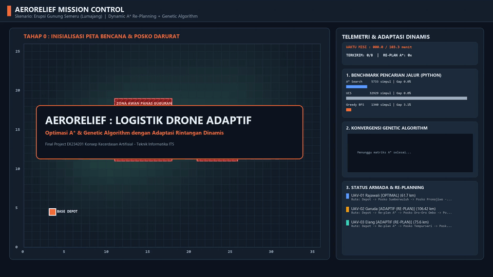
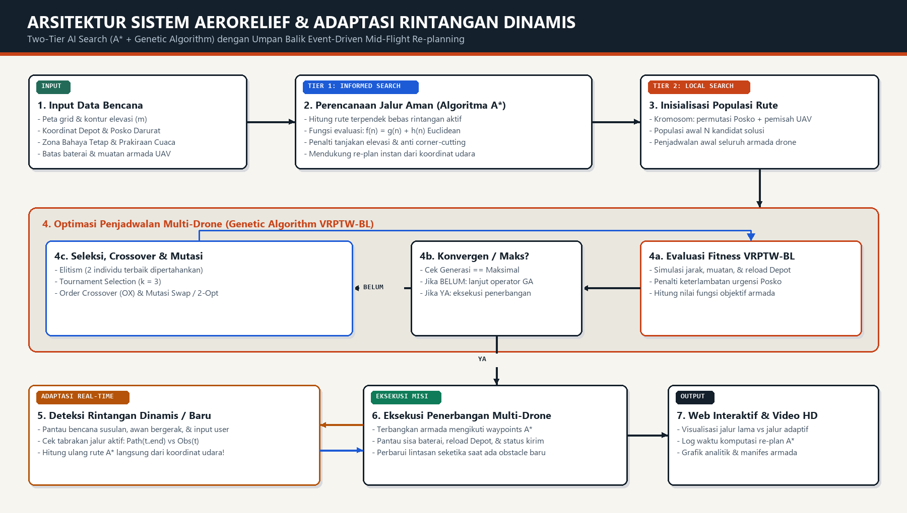
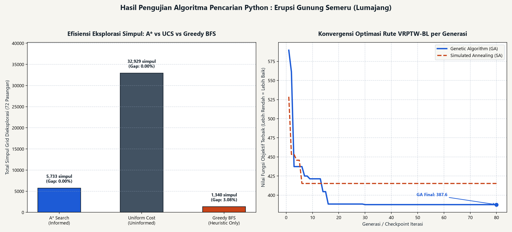

# Proposal & Progress Project KKA (Konsep Kecerdasan Artifisial)
**Departemen Teknik Informatika - Institut Teknologi Sepuluh Nopember (ITS)**

---

## 1. Topik & Judul Proyek
* **Topik:** Optimasi Rute dan Penjadwalan Pengiriman Logistik Medis Pasca Bencana Menggunakan Drone
* **Judul Proyek:**
  > **"AeroRelief: Optimasi Rute Pengiriman Logistik Medis Multi-Drone Pasca Bencana Menggunakan Algoritma A* dan Genetic Algorithm"**

---

## 2. Deskripsi Proyek (Project Description)
*AeroRelief* adalah sistem aplikasi berbasis Python yang dirancang untuk mengoptimalkan rute dan jadwal distribusi logistik bantuan medis darurat (seperti darah, obat-obatan esensial, insulin, tabung oksigen portabel, dan perlengkapan trauma) menggunakan armada *Unmanned Aerial Vehicles* (UAV / Drone) di daerah bencana yang akses daratnya lumpuh total.

Pada skenario pasca bencana alam di Indonesia (seperti Erupsi Gunung Semeru, Gempa & Longsor Cianjur, atau Banjir Bandang Demak), infrastruktur jalan dan jembatan sering kali terputus sehingga metode distribusi konvensional memakan waktu lama dan berisiko tinggi. *AeroRelief* mengatasi kendala ini dengan pendekatan dua tingkat (*two-tier optimization*):
1. **Tingkat Lokal & Adaptasi Dinamis (Perencanaan Jalur Topografi - Informed Search & Mid-Flight Re-planning):** Menggunakan algoritma **A\* (A-Star)** dengan heuristik jarak Euclidean dan penalti elevasi tanjakan untuk merencanakan lintasan terbang fisik terpendek yang aman dari zona terlarang (*no-fly zone*, awan panas, longsor, dan koridor SUTET). Selain rintangan statis, sistem mampu mendeteksi **rintangan yang berubah atau muncul mendadak di tengah penerbangan** (seperti pergeseran awan badai maupun bencana susulan) dan langsung mengeksekusi **Dynamic A\* Re-planning** dari koordinat udara terkini tanpa harus mengulang misi dari Depot.
2. **Tingkat Global (Alokasi & Penjadwalan Armada - Local / Heuristic Search):** Menggunakan **Genetic Algorithm (GA)** untuk memecahkan varian *Vehicle Routing Problem with Time Windows and Battery Limits* (VRPTW-BL), yaitu mengalokasikan titik-titik posko darurat ke masing-masing drone secara seimbang, menjadwalkan pengisian ulang baterai dan muatan di Base Depot, serta memprioritaskan posko berstatus urgensi **KRITIS**.

Aplikasi ini dilengkapi dengan **Aplikasi Web Interaktif** (Flask + HTML5 Canvas), **Dashboard Streamlit**, **Video Mockup HD 1080p**, serta **Deck Presentasi Progress (.pptx)** yang memvisualisasikan peta medan bencana, animasi pergerakan armada multi-drone, dan metrik komparasi performa algoritma secara kuantitatif.

---

## 3. Latar Belakang & Alasan Memilih Topik
1. **Urgensi Kemanusiaan & Realitas Bencana di Indonesia:**
   Indonesia berada di kawasan *Ring of Fire* yang memiliki frekuensi erupsi gunung berapi, gempa bumi, banjir bandang, dan tanah longsor yang sangat tinggi. Pada Erupsi Semeru (putusnya Jembatan Gladak Perak) maupun Gempa Cianjur, desa-desa terpencil terisolasi akibat jalur darat tertutup material bencana. Suplai medis darurat memiliki *golden hour*: keterlambatan pengiriman berakibat fatal bagi korban luka berat.
2. **Relevansi Kuat dengan Kurikulum Konsep Kecerdasan Artifisial (KKA):**
   Topik ini mengimplementasikan dua pilar utama dalam mata kuliah KKA secara terpadu dan komplementer:
   - **Informed Search (A\*):** Untuk navigasi lintasan titik-ke-titik menghindari rintangan dengan jaminan optimalitas (heuristik *admissible*), dibandingkan langsung dengan *Uniform Cost Search* (Uninformed) dan *Greedy Best-First Search*.
   - **Local / Heuristic Search (Genetic Algorithm):** Untuk penyelesaian masalah optimasi kombinatorial NP-hard (*Multi-Drone VRPTW-BL*), dibandingkan langsung dengan *Simulated Annealing*.
3. **Evaluasi Kuantitatif & Visualisasi Lengkap:**
   Permodelan koordinat grid topografi, kapasitas muatan, batas jarak baterai, dan urgensi waktu posko dievaluasi secara matematis dengan metrik terukur (*explored nodes, optimality gap, makespan, total distance, execution time*) dan disajikan melalui web interaktif serta video simulasi.

---

## 4. Metode & Algoritma yang Digunakan

### A. Informed Search: Algoritma A* (A-Star)
Digunakan untuk menghitung jalur terbang terpendek dan teraman bagi drone dari titik $u$ ke $v$ dengan memperhitungkan zona terlarang serta kontur ketinggian medan:
* **Biaya Langkah:** $\text{step\_cost}(u, v) = \text{dist}_{2D}(u, v) + \max(0, \text{elev}(v) - \text{elev}(u)) \times 0.004$
* **Fungsi Evaluasi:** $f(n) = g(n) + h(n)$
  * $g(n)$: Biaya akumulatif dari titik awal ke simpul $n$.
  * $h(n)$: Heuristik jarak Euclidean 2D $\sqrt{(x_2-x_1)^2 + (y_2-y_1)^2}$. Karena penalti elevasi selalu bernilai $\ge 0$, heuristik ini bersifat *admissible* dan *consistent*, sehingga menjamin solusi optimal.

### B. Local / Heuristic Search: Genetic Algorithm (GA)
Digunakan untuk menyelesaikan penugasan posko dan urutan rute multi-drone (*VRPTW-BL*):
* **Representasi Kromosom:** Permutasi urutan ID posko penerima bantuan beserta gen pemisah armada (`-100, -101, ...`).
* **Fungsi Objektif (Minimasi):**
  $$\text{Objective} = \text{TotalCost} + 0.35 \cdot \text{Makespan} + 2.5 \cdot \sum (\text{UrgencyWeight} \cdot \text{LateMin}) + \text{Penalty}$$
* **Operator Genetik:** *Elitism (2 individu)*, *Tournament Selection ($k=3$)*, *Order Crossover (OX)*, serta *Swap & 2-Opt Inversion Mutation*.

---

## 5. Cara Kerja & Flowchart Aplikasi

---

## 6. Hasil Benchmark & Mockup Aplikasi (Web & Video)
1. **Aplikasi Web Interaktif (`server.py` + `web/`):**
   - Mendukung 3 skenario bencana nyata (*Semeru, Cianjur, Demak*).
   - Panel konfigurasi algoritma (*A\*, UCS, Greedy BFS* dan *GA, Simulated Annealing*), slider parameter armada, serta alat **Editor Peta Interaktif** (tambah posko & lukis zona terlarang langsung di kanvas).
   - Dilengkapi toggle tema **Peta Topografi Terang** dan **Mode Operasi Malam** (WCAG AA), playback kontrol (*Putar/Jeda, 0.5x-4x, Scrubber*), serta tabel manifes armada interaktif.
2. **Video Mockup Simulasi Full HD (`media/aerorelief_mockup_demo.mp4`):**
   - Berdurasi 22 detik (1920x1080, 30 fps) yang memperlihatkan tahapan inisialisasi skenario Semeru, animasi ekspansi simpul A*, kurva konvergensi GA vs SA, hingga animasi penerbangan multi-drone.
3. **Deck Presentasi Progress (`AeroRelief_Progress_KKA.pptx`):**
   - Berisi 9 slide terstruktur yang siap dikumpulkan di Classroom.

---

## 7. Referensi Ilmiah & Studi Terkait
1. Dorling, K., Heinrichs, J., Messier, G. G., & Magierowski, S. (2017). *Vehicle Routing Problems for Drone Delivery*. IEEE Transactions on Systems, Man, and Cybernetics: Systems, 47(1), 70-85. https://ieeexplore.ieee.org/document/7513397
2. Russell, S., & Norvig, P. (2020). *Artificial Intelligence: A Modern Approach (4th Edition)*. Pearson. (Materi Informed Search & Local Search).
3. Maza, I., Caballero, F., Capitan, J., Martinez-de-Dios, J. R., & Ollero, A. (2011). *Multi-UAV Cooperation and Coordination for Search and Rescue Missions in Disaster Scenarios*. Autonomous Robots, 30(2), 141-155.
4. Open Source Reference: *PythonRobotics (A\* Grid Planning)* - https://github.com/AtsushiSakai/PythonRobotics
5. Repository Proyek: https://github.com/PopSharkkk/ArtificialConceptFinalProject
