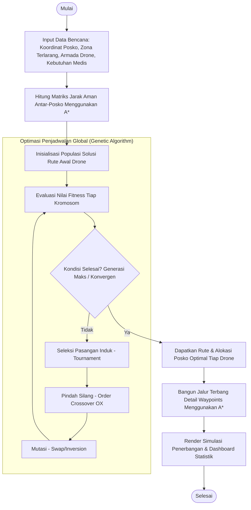

# Proposal & Progress Project KKA (Konsep Kecerdasan Artifisial)
**Departemen Teknik Informatika - Institut Teknologi Sepuluh Nopember (ITS)**

---

## 1. Topik & Judul Proyek
* **Topik:** Optimasi Rute dan Penjadwalan Pengiriman Logistik Medis Pasca Bencana Menggunakan Drone
* **Judul Proyek:** 
  > **"AeroRelief: Optimasi Rute Pengiriman Logistik Medis Multi-Drone Pasca Bencana Menggunakan Algoritma A* dan Genetic Algorithm"**

---

## 2. Deskripsi Proyek (Project Description)
*AeroRelief* adalah sistem aplikasi berbasis Python yang dirancang untuk mengoptimalkan rute dan jadwal distribusi logistik bantuan medis darurat (seperti darah, obat-obatan esensial, serum anti-bisa, dan perban) menggunakan armada *Unmanned Aerial Vehicles* (UAV / Drone) di daerah bencana yang akses daratnya lumpuh total.

Pada skenario pasca bencana alam (seperti gempa bumi, banjir bandang, atau tanah longsor), infrastruktur jalan seringkali terputus sehingga metode distribusi konvensional memakan waktu lama dan berisiko tinggi. *AeroRelief* mengatasi kendala ini dengan pendekatan dua tingkat (*two-tier optimization*):
1. **Tingkat Global (Alokasi & Penjadwalan Tugas - Local / Heuristic Search):** Menggunakan **Genetic Algorithm (GA)** atau **Simulated Annealing** untuk memecahkan varian *Vehicle Routing Problem with Time Windows and Battery Limits* (VRPTW-BL), yaitu mengalokasikan titik-titik posko darurat ke masing-masing drone agar pengiriman prioritas kritis dapat selesai sebelum batas waktu toleransi dan kapasitas baterai habis.
2. **Tingkat Lokal (Perencanaan Jalur 2D/3D - Informed Search):** Menggunakan algoritma **A\* (A-Star)** dengan fungsi heuristik Euclidean 3D dan *dynamic obstacle penalty* untuk merencanakan lintasan terbang fisik terpendek yang aman dari zona cuaca ekstrem, area reruntuhan/no-fly zone, serta kontur medan/topografi perbukitan.

Aplikasi ini dilengkapi dengan antarmuka simulasi interaktif (berbasis Pygame / Streamlit) yang memvisualisasikan peta medan bencana, status baterai dan kapasitas muatan setiap drone, pergerakan armada secara *real-time*, serta metrik performa algoritma (waktu komputasi, total jarak tempuh, dan tingkat keberhasilan pengiriman obat).

---

## 3. Latar Belakang & Alasan Memilih Topik
1. **Urgensi Kemanusiaan & Realitas Bencana di Indonesia:**
   Indonesia berada di kawasan *Ring of Fire* yang memiliki frekuensi gempa bumi, tsunami, dan tanah longsor yang sangat tinggi. Contoh pada gempa Cianjur atau Palu, desa-desa terpencil terisolasi berhari-hari akibat jalur darat longsor/jembatan roboh. Suplai medis darurat memiliki *golden hour*—keterlambatan beberapa jam dapat berakibat fatal.
2. **Relevansi Kuat dengan Kurikulum Konsep Kecerdasan Artifisial (KKA):**
   Topik ini mengimplementasikan dua pilar utama dalam mata kuliah KKA secara komplementer:
   - **Informed Search (A\*):** Untuk navigasi lintasan titik-ke-titik menghindari rintangan/no-fly zones dengan efisiensi optimal.
   - **Local / Heuristic Search (Genetic Algorithm / Simulated Annealing):** Untuk penyelesaian masalah kombinatorial kompleks NP-hard (Vehicle Routing Problem).
3. **Ketersediaan Data & Kemudahan Evaluasi Matematis:**
   Permodelan graf koordinat, kapasitas muatan, batas konsumsi daya baterai, dan rintangan dinamis dapat disimulasikan secara kuantitatif dengan metrik yang jelas (*path length, latency, energy consumption, execution time*).
4. **Potensi Nilai Tambah (Mockup & Visualisasi):**
   Topik ini sangat menarik dan intuitif ketika didemokan melalui visualisasi grafis interaktif (2D/3D visualizer), memenuhi kriteria penilaian demo dan mockup.

---

## 4. Metode & Algoritma yang Digunakan

### A. Informed Search: Algoritma A* (A-Star)
Digunakan untuk menentukan jalur terbang terpendek dan teraman bagi drone dari Titik A ke Titik B dengan memperhitungkan rintangan (*no-fly zones*, area cuaca buruk).
* **Fungsi Evaluasi:**
  $$f(n) = g(n) + h(n)$$
  * $g(n)$: Biaya akumulatif dari titik awal ke simpul $n$ (memperhitungkan jarak tempuh dan penalti elevasi).
  * $h(n)$: Heuristik jarak Euclidean langsung ke titik tujuan ($h(n) = \sqrt{(x_2-x_1)^2 + (y_2-y_1)^2 + (z_2-z_1)^2}$). Heuristik ini bersifat *admissible* (tidak pernah melebih-lebihkan biaya sebenarnya) sehingga menjamin solusi optimal.

### B. Local / Heuristic Search: Genetic Algorithm (GA)
Digunakan untuk menyelesaikan penugasan posko dan urutan rute multi-drone (*Multi-Depot Drone Routing Problem*).
* **Representasi Kromosom:** Permutasi urutan ID posko penerima bantuan dan pemisah rute antar-drone.
* **Fungsi Fitness:**
  $$\text{Fitness} = \frac{1}{\alpha \cdot \text{Total Distance} + \beta \cdot \text{Late Penalty} + \gamma \cdot \text{Battery Overuse Penalty}}$$
* **Operator Genetik:** *Tournament Selection*, *Ordered Crossover (OX)* untuk menjaga validitas permutasi rute, dan *Swap/Inversion Mutation*.

---

## 5. Alur Kerja / Flowchart Aplikasi

---

## 6. Rencana Mockup Antarmuka (UI/Dashboard)
Aplikasi akan dibangun menggunakan **Python** dengan antarmuka grafis interaktif (berbasis **Streamlit** atau **Pygame**):
1. **Interactive Disaster Map:** Menampilkan Basecamp (Depot), Posko Bencana (Titik Antar dengan warna indikator urgensi), dan Zona Terlarang (No-Fly Zone).
2. **Live Flight Animation:** Drone bergerak di sepanjang rute optimal mengirimkan suplai obat.
3. **Analytics Dashboard:**
   - Total Waktu Evakuasi/Distribusi.
   - Grafik Konvergensi Nilai Fitness Genetic Algorithm per generasi.
   - Perbandingan efisiensi A* vs Dijkstra/Greedy Best-First Search.
   - Sisa baterai dan muatan masing-masing drone.

---

## 7. Referensi Ilmiah & Studi Terkait
1. Dorling, K., et al. (2017). *Vehicle Routing Problems for Drone Delivery*. IEEE Transactions on Systems, Man, and Cybernetics: Systems, 47(1), 70-85.
2. Russell, S., & Norvig, P. (2020). *Artificial Intelligence: A Modern Approach (4th Edition)*. Pearson. (Materi Informed Search & Genetic Algorithms).
3. Maza, I., et al. (2011). *Multi-UAV Cooperation and Coordination for Search and Rescue Missions in Disaster Scenarios*. Autonomous Robots, 30(2), 141-155.
4. Open Source Reference: PythonRobotics (A* 2D/3D Grid & Motion Planning) - https://github.com/AtsushiSakai/PythonRobotics
