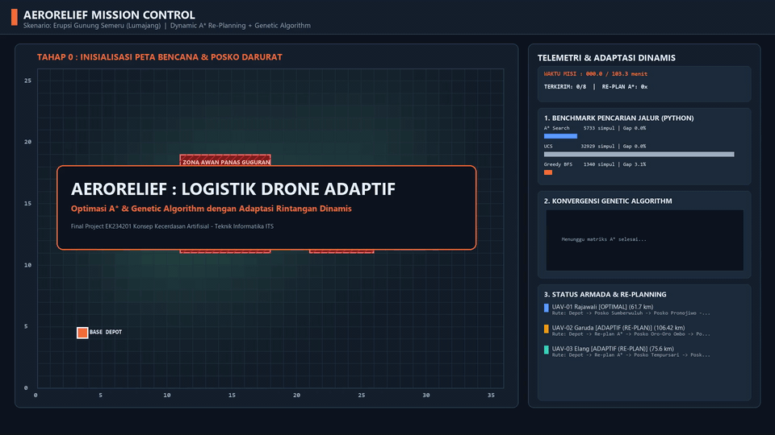

# AeroRelief : Optimasi Rute Drone Logistik Medis Pasca Bencana

> **Final Project Konsep Kecerdasan Artifisial (EK234201) - Departemen Teknik Informatika ITS**



**AeroRelief** adalah sistem perencanaan rute dan penjadwalan armada multi-drone berbasis Python untuk distribusi logistik medis darurat pada wilayah bencana dengan akses darat terputus.

---

## Algoritma Kecerdasan Artifisial yang Diimplementasikan
1. **Informed Search : Algoritma A\* & Event-Driven Mid-Flight Re-Planning** (dibandingkan dengan *Uniform Cost Search* & *Greedy Best-First Search*)
   - Menghitung lintasan terbang optimal di atas peta topografi elevasi yang menghindari *No-Fly Zone* tanpa *diagonal corner-cutting*:

$$
f(n) = g(n) + h(n), \quad h(n) = \sqrt{(x_2 - x_1)^2 + (y_2 - y_1)^2}
$$

   - **Adaptasi Rintangan Dinamis / Bergerak:** Mendeteksi rintangan baru (longsor susulan, guguran lava, input rintangan mendadak oleh pengguna) maupun awan badai yang bergeser mengikuti waktu. Drone yang jalurnya terhalang otomatis menghitung ulang jalur memutar `A*` langsung dari koordinat udaranya saat itu tanpa mengulang dari Depot.
2. **Local / Heuristic Search : Genetic Algorithm (VRPTW-BL)** (dibandingkan dengan *Simulated Annealing*)
   - Mengoptimalkan penugasan posko multi-drone dengan memperhitungkan batas kapasitas muatan, jangkauan baterai (termasuk *reload* di Depot), dan penalti keterlambatan berdasarkan tingkat urgensi (*KRITIS, TINGGI, SEDANG*):

$$
\text{Objective} = \text{TotalCost} + 0.35 \cdot \text{Makespan} + 2.5 \cdot \sum (\text{UrgencyWeight} \cdot \text{LateMin}) + \text{Penalty}
$$

---

## Cara Menjalankan Proyek

### 1. Instalasi Dependensi
```bash
pip install -r requirements.txt
```

### 2. Jalankan Aplikasi Web Interaktif (Flask + HTML5 Canvas)
```bash
python server.py
```
Buka browser di **`http://127.0.0.1:5050`**.  
Fitur web: 3 skenario bencana Indonesia (*Semeru, Cianjur, Demak*), editor peta interaktif (*tambah posko & lukis zona terlarang*), benchmark algoritma secara langsung, manifes penerbangan armada, mode Terang/Malam, pemutar Video Mockup HD, dan unduhan file presentasi PPTX.

### 3. Jalankan Alternatif Dashboard Streamlit
```bash
streamlit run app_mockup.py
```

### 4. Jalankan Pengujian Otomatis (`unittest`)
```bash
python -m unittest discover -s tests -v
```

---

## Struktur Berkas & Materi Presentasi
- [`aerorelief/`](aerorelief/) : Paket inti Python (`models.py`, `environment.py`, `pathfinding.py`, `routing.py`, `dynamic.py`, `scenarios.py`, `solver.py`)
- [`server.py`](server.py) & [`web/`](web/) : Aplikasi web *full-stack* interaktif
- [`app_mockup.py`](app_mockup.py) : Dashboard interaktif berbasis Streamlit
- [`media/aerorelief_mockup_demo.mp4`](media/aerorelief_mockup_demo.mp4) : **Video Mockup Simulasi Full HD (1080p, 30 fps)**
- [`media/flowchart_sistem.png`](media/flowchart_sistem.png) & [`media/benchmark_algorithms.png`](media/benchmark_algorithms.png) : Diagram alur & grafik benchmark
- [`AeroRelief_Progress_KKA.pptx`](AeroRelief_Progress_KKA.pptx) : **Slide Presentasi Progress KKA (9 Slide siap kumpul)**
- [`PROPOSAL_PROJECT_KKA.md`](PROPOSAL_PROJECT_KKA.md) : Dokumen lengkap proposal & metodologi
